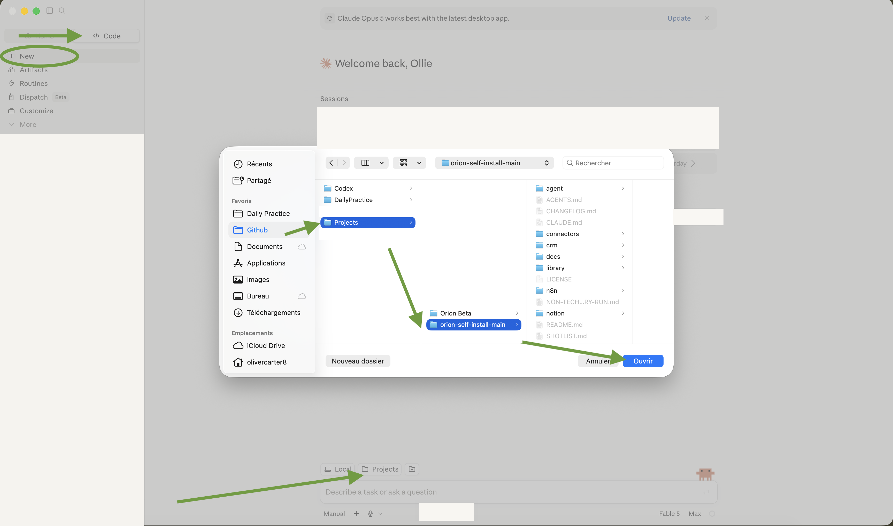
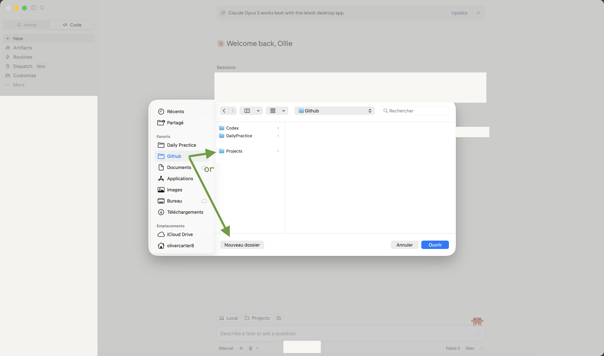

# Orion — turn your own AI assistant into your sales agent

Orion is a personal sales agent that learns your business, your customers, and how you
actually sell — then takes on the parts of selling that aren't talking to people. You
tell it about a prospect; it researches them and drafts a message for you to look over.
After a call, you tell it how it went; it writes the summary, updates your pipeline, and
drafts your follow-up. What goes out on its own is up to you: you set a risk level, and
nothing sends above it.

Nobody sits with you for this. Your own AI assistant — Claude, ChatGPT,
Copilot, Codex, whichever you already use — installs it with you, using the files in
this folder. This page is the control panel: **Press Start** below gets you going in
three small moves; **the Library** underneath it is where you add capabilities, today or
months from now.

**Three things worth knowing before you start:**

- **You don't need to know how to code, and you don't need to install anything new**
  beyond an AI assistant you probably already have.
- **This usually takes a few sittings, not one.** You can stop anytime — see
  ["You can stop anytime"](#you-can-stop-anytime-and-pick-up-right-where-you-left-off)
  below — and nothing is lost.
- **Nothing happens without you saying yes.** Not one email, not one change to your
  contacts list, ever, without you approving it first. More on this below.
- **It keeps up without you.** Daily Practice ships improvements as numbered
  [releases](https://github.com/DailyPractice-Ltd/orion-self-install/releases). Ask your
  AI "what version is my harness on?", and if it is behind, say "update my harness".
  Your edits and business records are preserved by the update rules
  ([how updates and backups work](docs/updating.md)).

---

## ▶ Press Start

Download this release, then create your own Orion folder with one command. Choose the
AI tool that will run your harness. Without GitHub options, this creates a local Git repository:

```bash
node install.mjs --tool codex --target /path/to/my-orion
# or
node install.mjs --tool claude-code --target /path/to/my-orion
```

The target must be a new or empty folder outside this release. The installer creates
a separate local Git repository, copies the three Orion skills into your chosen
tool's layout with its team roster, and records that choice in `status/status.json`.
It leaves the release sources, tests, and project specifications behind. Then enter your new folder and
press Start:

```bash
cd /path/to/my-orion
node start.mjs
```

The wizard checks your computer, offers the radio choice, and gives you the prompt
to start working with your AI assistant. Keep this client folder as your business's
Orion home. The downloaded release folder is only the source for installing and
updating it. If you already created an empty
private repository, use `--remote https://github.com/YOUR-USERNAME/my-orion.git`
instead; the installer verifies that it is private and pushes the new harness.
For a private GitHub home during installation, add `--github-repo OWNER/NAME` after signing in with `gh auth login`. `--local-only` is an optional explicit form of the local default.
Its GitHub home stays off until you set up a private remote with
`node status/home.mjs prepare --remote <its-address> --yes` in the client folder.

`AGENTS.md` is the shared instruction file in either layout. The installer does not
copy `CLAUDE.md`. Anthropic's optional `agents-md` plugin can load `AGENTS.md` when
there is no `CLAUDE.md` in scope; this depends on the client's Claude Code setup.
For an older setup that does not load it, add a client-folder `CLAUDE.md` containing
only `@AGENTS.md`. Keep the shared instructions in one place.

---

## 📚 The Library — add capabilities anytime

Honest mechanics: on this website a "button" is a link. Each one opens a package page
whose **first block is the exact text to paste into your AI** — your AI installs it
from there, fits it to your business, and proves it works on your real data.

**Agents** — a colleague with a job:

- **[Prospecting](library/agents/prospecting/PACKAGE.md)** — ~20 researched
  candidates that match your ideal customer, each with a one-line "why them."
- **[Call-Planner Control Tower](library/agents/call-planner/PACKAGE.md)** — who to
  call today, in what order, with context and the angle.
- **[Friday Report](library/agents/friday-report/PACKAGE.md)** — the week's honest
  scoreboard, drafted for you.

**Skills** — one teachable capability:

- **[Meeting Sizing](library/skills/meeting-sizing/PACKAGE.md)** — every meeting gets
  an outcome, a decision-maker, and the shortest useful length.

**Workflows** — automated chains, gated on your yes:

- **[Prospect Research → Outreach](library/workflows/prospect-research-outreach/PACKAGE.md)**
  — a prospect's name in, researched draft out, waiting in your Drafts.
- **[Post-Call Debrief](library/workflows/post-call-debrief/PACKAGE.md)** — call notes
  in; summary, CRM update and follow-up draft out.

**Programs**, the operating rhythms your agent runs with you:

- **[Revenue Operating Cadence](library/programs/revenue-operating-cadence/PACKAGE.md)**
  — the daily/weekly/monthly beat that moves revenue from attention to collected cash.

More about how packages work (and what "installed" honestly means):
[the Library's own page](library/README.md).

---

## Step 1 — Get the release files

On this GitHub page, select **Code → Download ZIP**, then extract the ZIP. You can
also clone the release repository with git. This folder is the release source; your
business's records will live in a different folder.

## Step 2 — Choose your client folder

Pick a permanent location for your Orion folder, such as `Projects/my-orion`. Its
parent folder must already exist. The Orion folder itself may be new or empty. Keep
it outside the downloaded release folder.

## Step 3 — Install and Press Start

Open Terminal (Mac) or Windows Terminal (Windows). Type `cd `, drag the extracted
release folder into the terminal window, and press Enter. Sign in with
`gh auth login`, then run the install command for the tool you use. Replace
`YOUR-USERNAME` with your GitHub username:

```bash
node install.mjs --tool codex --target /path/to/my-orion
# or
node install.mjs --tool claude-code --target /path/to/my-orion
```

Replace `/path/to/my-orion` with the location you chose in Step 2. If it contains
spaces, put the path in quotation marks. The command prints the exact next step:
enter your new client folder and run `node start.mjs` there. The wizard saves its
answers in that client's `status/status.json`, never in the release checkout.

The local repository is ready immediately. Add `--github-repo YOUR-USERNAME/my-orion` to create and push a private GitHub repository during installation, or connect one later with `node status/home.mjs prepare --remote <address> --yes`. If you have an existing empty private repository, use
`--remote https://github.com/YOUR-USERNAME/my-orion.git` instead.

If Node.js, git, or the GitHub CLI is missing, install it before using the private
GitHub path, or install locally for now. You can also ask your
AI assistant to help with the manual setup.

---

## Step 4 — Open Orion with your AI assistant

Whatever AI you use — Claude, ChatGPT, Copilot, Codex, Cursor, or something else — the
move is always the same: **if your AI can open folders, open Orion's folder with it; if
it can't, hand it one file (`AGENTS.md`)**. Pick whichever description below sounds
like you; if you ran the wizard, it already told you which lane is yours.

### Opening Orion from your desktop agent

This is for AI apps that live on your computer and can open folders: the **Claude**
desktop app (its **Code** tab), **Codex**, **Claude Code**, **Cursor**, or **VS Code
with Copilot**.

1. Open your AI app.
2. Find its open-a-folder control — in the Claude app: click **Code** near the top,
   then its folder/project picker; in Cursor or VS Code: **File → Open Folder…**; in a
   terminal agent (Claude Code, Codex): do Step 3's `cd` trick, then type `claude` or
   `codex` and press Enter.
3. Navigate to the client folder created in Step 3 and open it.
4. Say: **"Read AGENTS.md and let's get started."** (Or paste the fuller prompt the
   wizard printed.)

<!-- SCREENSHOT: docs/img/05-desktop-agent-open-folder.png
     alt: "A desktop AI agent's folder picker open at Github → Projects with the orion-self-install-main folder selected"
     caption: "In your desktop agent, open the client folder created by the installer." -->


**You'll know it worked when**: it introduces itself and asks about your business —
not about your computer.

### Just a website — no app needed, always works

A website chat can't reach into folders on your computer, so you hand it the brief
directly. The move is the same on every AI website: **make a dedicated space, and give
it the file `AGENTS.md` from your Orion folder** — the same everyday action as
attaching a file to an email. What that space is called depends on the tool:

- **Claude** (claude.ai): **Projects → New Project** — name it anything, "My Orion" is
  fine — then add `AGENTS.md` via its add-files/knowledge button.
- **ChatGPT** (chatgpt.com): **Explore GPTs → Create** (needs a paid plan — on the free
  plan, use the copy-paste route below instead; it works just as well).
- **Copilot** (Microsoft 365): look for **Create agent**.

<!-- SCREENSHOT: docs/img/06a-claude-project-create.png
     alt: "The claude.ai interface showing the 'Create project' button and a newly named project"
     caption: "Example, in claude.ai: Projects → Create project → name it 'My Orion'. Every AI website has an equivalent." -->


<!-- SCREENSHOT: docs/img/06b-claude-project-upload-files.png
     alt: "The Project settings screen in claude.ai with the file upload button highlighted and AGENTS.md selected"
     caption: "Then add one file from your Orion folder: AGENTS.md." -->


Then start chatting and say: **"Read AGENTS.md and let's get started."** As it asks for
anything else it needs (it will tell you exactly what and why), upload that file the
same way — you'll never touch more than a handful of files.

**You'll know it worked when**: it introduces itself and starts asking about your
business — not about the file you just uploaded.

**If uploading files isn't working for some reason**: open `AGENTS.md` in any plain
text program (Notes, Notepad, TextEdit — whatever came with your computer), select all
the text, copy it, and paste it directly as your first message instead. This always
works, on anything that can have a conversation with you. (On Windows, if
double-clicking the file doesn't open anything obvious, right-click it and choose
**Open with → Notepad**.) One difference with this path: since there's no file for it
to check on its own, it'll show you a short block of text before you finish each
session and ask you to save it (a Notes app is fine) — paste that back first next time,
so it still knows exactly where you left off.

---

## Step 5 — Just talk to it

From here, your AI assistant runs the conversation. It'll introduce itself, ask about your
business in your own words, and walk you through connecting the few tools it needs — your
contacts/deals tracker (your **CRM** — short for "customer relationship management," just
the tool or spreadsheet where you keep track of who you're talking to), your email, and
your calendar — one plain step at a time. If something needs a click you don't recognise,
it'll explain what it's for before asking you to do it.

---

## Once installed, use Orion from any project

The folder you homed in Step 2 is Orion's memory — your knowledge base, your bookmark
file, your installed packages all live there. But you don't have to "go there" to work:
your AI remembers it as one of your projects. Tomorrow, next month, mid-way through
something else entirely — open your AI, switch to your Orion project (desktop agents
keep a recent-folders list; websites keep the space you made), and say **"let's
continue"** or just start working. One download, one home, then it's simply *there*,
one switch away, whatever you're working on.

<!-- SCREENSHOT: docs/img/07-use-orion-from-any-project.png
     alt: "A desktop AI agent's folder picker at the Github folder level, with arrows showing you can hop into Projects — or any folder — and Orion is one open away"
     caption: "Later, from anywhere: your agent's folder picker gets you back to Orion (or into any other project) in two clicks." -->


---

## You can stop anytime and pick up right where you left off

Most people don't finish this in one go, and that's completely normal. If you need to
close your laptop, go to a meeting, or come back next week — go ahead. Nothing is lost.

When you're ready to continue, just open the same folder with your AI assistant again (it
doesn't even have to be the same one you started with) and say something like **"let's
continue."** It will already know exactly what you've done so far and pick up from there —
you'll never have to answer the same question twice. (The wizard works the same way:
running `node start.mjs` again greets you with exactly where things stand.)

---

## What this will never do

- **Nothing sends above the risk level you chose.** Every message your agent wants to
  send is scored first. Inside your level (low to start: replies and logistics) it goes on
  its own; above it, the draft waits for you with the score and what would bring it
  inside. Say "set my risk to medium" or "pause sending" and it changes at once. The whole
  matrix, in plain words: [`agent/risk-matrix.md`](agent/risk-matrix.md).
- **It won't write anything that could embarrass you or your business.** If you ask for
  something that crosses a line, it'll tell you plainly and suggest a better way — not
  just refuse and leave you stuck.
- **It won't send information about your business anywhere without telling you.** Orion
  can keep a small check-in "radio" open with Daily Practice. It shares which install
  step you're on, what kind of task finished (a general tag such as "prospecting", a
  count, and which skill or agent ran), and which packages you have. Never the
  content of anything. It's presented to you plainly as a pre-ticked choice you can decline with
  one keystroke, during setup, and you can switch it off anytime after.
  [The radio, in plain words](docs/radio.md) is the whole story — no fine print.

---

## If you get stuck

Your AI assistant should be able to work through almost anything using this download
alone — that's what it's built for. If it genuinely can't help, reach out to
**support@dailypractice.world**.

---

*Testing this repository rather than installing it for yourself? See
`NON-TECHNICAL-DRY-RUN.md` before you start — it's a protocol, not a suggestion.*

---

*For Daily Practice maintainers evolving this repository itself — not installing it for a
client — the technical specifications live in `specs/001-self-install/`
and `specs/002-production-line/`.*
