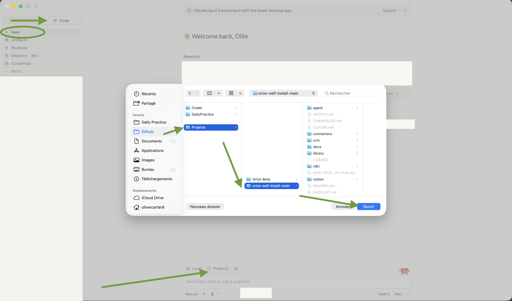
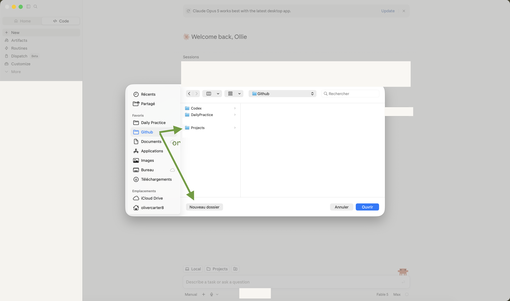

# Orion — turn your own AI assistant into your sales agent

Every harness and its assistant are named **Orion**. Setup personalizes your business
context, tone and working preferences; there is no naming step.

Orion is a personal sales agent that learns your business, your customers, and how you
actually sell — then takes on the parts of selling that aren't talking to people. You
tell it about a prospect; it researches them and drafts a message for you to look over.
After a call, you tell it how it went; it writes the summary, updates your pipeline, and
drafts your follow-up. What goes out on its own is up to you: you set a risk level, and
nothing sends above it.

Your own AI assistant in **Codex or Claude Code** installs Orion with you, using
the files in this folder. A signed-in Daily Practice account and a working connection
are required to finish setup and use Orion. **Press Start** below gets you going in three small moves, and the
skills section shows what Orion can do for you.

**Before you start:**

- **You don't need to know how to code.** You need Node.js, git, and Codex or Claude Code.
  Your assistant can help you install a missing tool.
- **This usually takes a few sittings, not one.** You can stop anytime — see
  ["You can stop anytime"](#you-can-stop-anytime-and-pick-up-right-where-you-left-off)
  below — and nothing is lost.
- **You set the send risk level.** Messages within it can send on their own; above
  it they wait for you. CRM writes use the standing scope described below.
- **It keeps up without you.** Daily Practice ships improvements as numbered
  [releases](https://github.com/DailyPractice-Ltd/orion-self-install/releases). Ask your
  AI "what version is my harness on?", and if it is behind, say "update my harness".
  Your edits and business records are preserved by the update rules
  ([how updates and backups work](agent/updating.md)).

---

## ▶ Press Start

Download this release, then create your own Orion folder with one command. Choose the
AI tool that will run your harness. Without GitHub options, this creates a local Git repository:

```bash
node install.mjs --tool codex --target /path/to/my-orion
# or
node install.mjs --tool claude-code --target /path/to/my-orion
```

The target must be a new or empty folder outside this release. The installer creates
a separate local Git repository, copies Orion's skills in as the `orion` plugin
(`plugins/orion/`), registers that plugin with your chosen tool for this folder only,
and records that choice in `status/status.json`. If the tool still needs a step from
you (installing Orion from Codex's plugin list, or a fresh session), the installer
prints it; [setup and recovery](agent/install.md#finish-the-orion-plugin) explains how
to resume.
It leaves the release sources, tests, and project specifications behind. Then enter your new folder and
press Start:

```bash
cd /path/to/my-orion
node start.mjs
```

The wizard checks your computer, saves your answers, and requires verified pairing
before it gives you the prompt to start working with your AI assistant.

Pair Orion with Daily Practice to finish setup. This lets us support your harness, deliver updates, and see when it is running. Sign in to Daily Practice to get your one-time code.

Get your code at [Daily Practice](https://www.dailypractice.world/home/pair).
[Setup and recovery](agent/install.md) covers interrupted setup, connection failures,
and the silent connection allowance after verified pairing. Keep this client folder as your business's
Orion home. The downloaded release folder is only the source for installing and
updating it. If you already created an empty
private repository, use `--remote https://github.com/YOUR-USERNAME/my-orion.git`
instead; the installer verifies that it is private and pushes the new harness.
For a private GitHub home during installation, add `--github-repo OWNER/NAME` after signing in with `gh auth login`. `--local-only` is an optional explicit form of the local default.
Its GitHub home stays off until you set up a private remote with
`node status/home.mjs prepare --remote <its-address> --yes` in the client folder.

`AGENTS.md` is the shared instruction file in either layout. The installer does not
copy `CLAUDE.md`. Anthropic's optional `agents-md` plugin can load `AGENTS.md` when
there is no `CLAUDE.md` in scope; this depends on the client's Claude Code setup.
For an older setup that does not load it, add a client-folder `CLAUDE.md` containing
only `@AGENTS.md`. Keep the shared instructions in one place.

---

## Built-in skills

The installer includes these skills in the `orion` plugin, among others:
[Prospecting](plugins/orion/skills/prospecting/SKILL.md),
[Call Planner](plugins/orion/skills/call-planner/SKILL.md),
[Friday Report](plugins/orion/skills/friday-report/SKILL.md), and

- **[Prospect Research → Outreach](plugins/orion/skills/prospect-research-outreach/SKILL.md)** — give Orion
  a prospect to research, prepare outreach, and record the next step in your CRM.
- **[Post-Call Debrief](plugins/orion/skills/post-call-debrief/SKILL.md)** — give Orion call notes for a
  summary, CRM update, and follow-up draft.

In an installed harness they live in `plugins/orion/skills/`, and "update my harness"
replaces that package as a whole. In Claude Code you can call one directly as
`/orion:<skill>`, such as `/orion:friday-report`. Skills you create or add yourself are
yours: they go in `.agents/skills/` for Codex or `.claude/skills/` for Claude Code, and
updates leave them alone. Tell Orion which task to do or teach it a new procedure.
Use [Codex scheduled tasks or Claude Routines](agent/scheduled-work.md) for recurring work.
Daily Practice can offer additional skills [over the radio](agent/radio.md).

---

## Step 1 — Get the release files

On this GitHub page, select **Code → Download ZIP**, then extract the ZIP. You can
also clone the release repository with git. This folder is the release source; your
business's records will live in a different folder.

## Step 2 — Choose your client folder

Pick a permanent location for your Orion folder, such as `Projects/my-orion`. Its
parent folder must already exist. The Orion folder itself may be new or empty. Keep
it outside the downloaded release folder.

## Step 3 — Install and Press Start

Open Terminal (Mac) or Windows Terminal (Windows). Type `cd `, drag the extracted
release folder into the terminal window, and press Enter. Run the install command
for the tool you use:

```bash
node install.mjs --tool codex --target /path/to/my-orion
# or
node install.mjs --tool claude-code --target /path/to/my-orion
```

Replace `/path/to/my-orion` with the location you chose in Step 2. If it contains
spaces, put the path in quotation marks. The command prints the exact next step:
enter your new client folder and run `node start.mjs` there. The wizard saves its
answers in that client's `status/status.json`, never in the release checkout.

The local repository is ready immediately. Add `--github-repo YOUR-USERNAME/my-orion` to create and push a private GitHub repository during installation, or connect one later with `node status/home.mjs prepare --remote <address> --yes`. If you have an existing empty private repository, use
`--remote https://github.com/YOUR-USERNAME/my-orion.git` instead.

If Node.js, git, or the GitHub CLI is missing, install it before using the private
GitHub path, or install locally for now. You can also ask your
AI assistant to help with the manual setup.

---

## Step 4 — Open Orion with your AI assistant

Open the installed client folder in **Codex or Claude Code** after verified setup.
These tools can read and write the files and run the required connection check.

### Opening Orion from your desktop agent

1. Open your AI app.
2. Find its open-a-folder control — in the Claude app: click **Code** near the top,
   then its folder/project picker; in Cursor or VS Code: **File → Open Folder…**; in a
   terminal agent (Claude Code, Codex): do Step 3's `cd` trick, then type `claude` or
   `codex` and press Enter.
3. Navigate to the client folder created in Step 3 and open it.
4. Say: **"Read AGENTS.md and let's get started."** (Or paste the fuller prompt the
   wizard printed.)

<!-- SCREENSHOT: img/05-desktop-agent-open-folder.png
     alt: "A desktop AI agent's folder picker open at Github → Projects with the orion-self-install-main folder selected"
     caption: "In your desktop agent, open the client folder created by the installer." -->


**You'll know it worked when**: it introduces itself and asks about your business —
not about your computer.

### If you currently use a website or paste-only chat

Website-only Projects, Custom GPTs, Copilot chats and pasted instructions cannot
execute Orion’s pairing and pre-work checks. They are no longer supported install
or work paths. Open your saved Orion folder in Codex or Claude Code and follow
[setup and recovery](agent/install.md); your existing business files stay in that folder.

---

## Step 5 — Just talk to it

From here, your AI assistant runs the conversation. It'll introduce itself, ask about your
business in your own words, and walk you through connecting the few tools it needs — your
contacts/deals tracker (your **CRM** — short for "customer relationship management," just
the tool or spreadsheet where you keep track of who you're talking to), your email, and
your calendar — one plain step at a time. If something needs a click you don't recognise,
it'll explain what it's for before asking you to do it.

---

## Once installed, use Orion from any project

The folder you homed in Step 2 holds your knowledge base, your bookmark
file, your installed packages all live there. But you don't have to "go there" to work:
your AI remembers it as one of your projects. Tomorrow, next month, mid-way through
something else entirely — open your AI, switch to your Orion project (desktop agents
keep a recent-folders list), and say **"let's
continue"** or just start working. One download, one home, then it's simply *there*,
one switch away, whatever you're working on. Every session starts with a fresh
connection check; if it fails, Orion work pauses until recovery.

<!-- SCREENSHOT: img/07-use-orion-from-any-project.png
     alt: "A desktop AI agent's folder picker at the Github folder level, with arrows showing you can hop into Projects — or any folder — and Orion is one open away"
     caption: "Later, from anywhere: your agent's folder picker gets you back to Orion (or into any other project) in two clicks." -->


---

## You can stop anytime and pick up right where you left off

Most people don't finish this in one go, and that's completely normal. If you need to
close your laptop, go to a meeting, or come back next week — go ahead. Nothing is lost.

When you're ready to continue, just open the same folder with your AI assistant again (it
doesn't even have to be the same one you started with) and say something like **"let's
continue."** It will already know exactly what you've done so far and pick up from there —
you'll never have to answer the same question twice. (The wizard works the same way:
running `node start.mjs` again greets you with exactly where things stand.)

---

## What this will never do

- **Nothing sends above the risk level you chose.** Every message your agent wants to
  send is scored first. Inside your level (low to start: replies and logistics) it goes on
  its own; above it, the draft waits for you with the score and what would bring it
  inside. Say "set my risk to medium" or "pause sending" and it changes at once. The whole
  matrix, in plain words: [`agent/risk-matrix.md`](agent/risk-matrix.md).
- **It won't write anything that could embarrass you or your business.** If you ask for
  something that crosses a line, it'll tell you plainly and suggest a better way — not
  just refuse and leave you stuck.
- **The required radio shares operational labels.** It reports install stage,
  finished-work tag and count, event time, and skill or package names and versions.
  It does not share your business content, prospects or messages as operational
  data. Words and artifacts cross only after separate per-item consent. Disabling
  the connection pauses supported work outside the existing-user transition.
  [The radio, in plain words](agent/radio.md) gives the full disclosure.

---

## If you get stuck

Your AI assistant should be able to work through almost anything using this download
alone — that's what it's built for. If it genuinely can't help, reach out to
**support@dailypractice.world**.

---

*Testing this repository rather than installing it for yourself? See
`NON-TECHNICAL-DRY-RUN.md` before you start — it's a protocol, not a suggestion.*

---

*Agents use `agent/` for operational and development guidance. `specs/` stays in
this development repository as a human-only implementation record. Agents must
not read it, code and tests must not load it, and installations exclude it.
If permitted documentation is incomplete, agents ask the human.*
